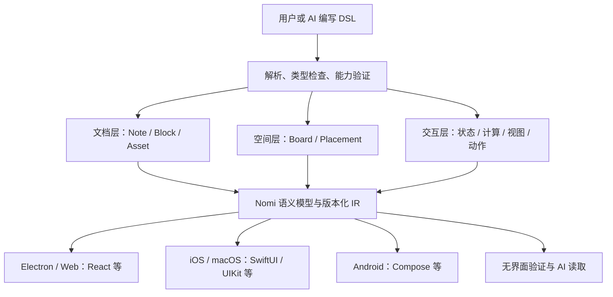

# 生成式交互内容与跨平台 DSL

状态：2026-10-18 架构提案修订；2026-10-19 已实现交互 IR / TypeScript runtime、React 温度探索器与 Swift 计算参考。实际范围见 [运行时说明](interactive-learning-runtime.md)，同日已补齐 [画布主工作区](canvas-workspace-runtime.md) 与本地笔记 / 附件 / 交互块；截至 2026-11-09，文稿 / 画布 AI 生成已接入受限交互 IR，见 [AI 生成实现](canvas-ai-generation.md)；原生交互 UI、手写与同步仍待实现。最新的多端呈现、能力扩展与 Web 扩展提案见 [交互块 v2](interactive-content-v2.md)；portable v2 第一版已实现，Web 扩展与原生移动 renderer 尚未实施。用户明确要求交互学习与 AI GenUI，并要求将来可用 SwiftUI / UIKit、Android Compose 等原生实现。本提案更新 [笔记与画布设计](notes-infinite-canvas.md) 中“共享 TypeScript / WebView”的实现假设；完整笔记、无限画布、Markdown / LaTeX、手写和本地优先目标继续保留。

## 产品命名

内容类型统一称为 **交互块**（Interactive Block），用于文稿、画布、插入菜单、AI 生成入口、导出文案与当前设计文档。它涵盖互动演示、交互实验、图表、测验和小工具；这些是内容用途，不代表当前运行时已支持全部能力。画布负责组织空间，交互块负责可操作、可响应的内容。

「交互实验」仅用于具体的实验类内容，不再作为通用类型或入口名称；历史记录保留当时称呼，搜索可继续接受旧关键词。底层 `InteractiveBlock`、`interactive` 类型、现有内部 `experiment` 操作标识和文件格式保持兼容，不因显示名称调整而迁移已有资料。

## 本轮结论

Nomi 的核心协议需要同时表达文档内容、空间视图和可运行的交互内容。新增一等 `InteractiveBlock`：可以出现在笔记中、画布中，也可以由 AI 在对话里生成，之后保存为长期内容。

跨端一致的对象包括语义节点、状态、计算、动作、能力要求与版本。React、SwiftUI、Compose、Canvas、系统地图都是宿主选择的实现。TypeScript 可以作为首批参考实现，不是所有客户端必须运行的语言；WebView 是兼容途径，不是移动端架构前提。

推荐在受限范围内复用 OpenUI 的生成语法、parser / evaluator 与 React reference renderer，建立 Nomi 自己的平台中立组件 catalog 和语义契约。KDL 仍可作为文档结构的语法候选，但不再先锁定为覆盖所有交互计算的唯一表达。优先验证协议和交互行为，再选最终文本编码。

## 从两个项目得到的证据

本地检查版本：OpenUI `8d9c4c3b108a7b5352192a6a9d7327bdf7ea19b5`；Open Intelligent UI `03213439358bf3408ad61a46ec9e3230c5572e48`。详细源码证据见 [参考评估](../references/openui-genui-review.md)。

- OpenUI 的框架无关 `lang-core` 定义 parser、AST、evaluator、state、functions、actions、query / mutation 和增量源码编辑；React renderer 单独绑定组件。它已有跨语言 conformance fixtures。
- Open Intelligent UI 是该协议上的参考应用，用 schema 注册 Slider、Chart、Map、Math 等组件及计算函数。输入改变状态后本地重算，不需要每次再问模型。
- OpenUI 有 React Native 示例，可以作为“同一描述、不同组件实现”的参考；不能据此宣称已经有完整 Swift / Kotlin 原生内核。
- 参考应用也有 `HtmlView`，在 iframe 中执行 HTML / JS。这是额外的 Web 扩展路径，不能据此推导任意生成页面都能独立原生实现。

因此，优先复用语言 / 组件 / 状态的分层与测试方法，不把 Next.js demo、外部 gateway、默认动作、CSS 和整个参考 catalog 一起变成 Nomi 的必要依赖。

## Nomi DSL 的三个语义层

IR 是领域协议的结构化形态，保留未求值的表达式、状态绑定、动作及节点身份。它不能只是某次求值后的组件树，更不能是 DOM 或截图。文本 DSL 是该模型的作者界面与可移植表示；JSON 样例用于审查结构，不代表已经决定生产文件扩展名。

一套语义允许多个作者前端，但不能有两份可独立覆盖的内容：OpenUI 文本、KDL 文本或可视编辑都先编译 / 比较，再通过命令修改同一语义模型。作者源码带编译器 / catalog / profile 版本与内容 hash，失配时重新编译或保留诊断；不能继续展示新 IR 却把旧源码当成当前文档。

## InteractiveBlock 是文档内容

文档模型增加以下对象：

| 对象 | 内容 | 生命周期 |
| --- | --- | --- |
| ProgramDefinition | UI 语义树、状态声明、表达式图、动作、数据和依赖 | 文档版本、协作编辑、可导出 |
| InteractiveBlock | 一个程序实例的稳定 ID、程序引用和初始参数 | 与 Markdown / Ink 同级，可在多个位置展示 |
| UserStudyState | 当前温度、所选 tab、练习答案、阅读进度等个人值 | 用户私有，可在本人设备间恢复 |
| ViewSession | hover、光标、拖动中间值、图表临时选区和相机 | 当前视图 / 设备，不默认同步 |
| PublishedScenario | 用户明确保存的一组参数或作答结果 | 成为可共享、可引用的文档内容 |
| DataSnapshot | 图表数据、单位、来源、时间与有效性 | 随文档保存，或按明确能力刷新 |

同一个 InteractiveBlock 在画布和笔记里展示时，默认共享当前用户的 UserStudyState；新建独立 Block 才获得独立练习状态。多位家庭成员查看同一课程时，各有自己的滑块和答案。共享文档更新组件不应清空个人进度。

这意味着上一版“选区 / UI 状态本地不共享”需要细分：相机仍是视图状态，但有学习价值的参数是个人持久状态，不能全部丢弃，也不能全部写进共享 CRDT。拖动实时值留在本机，释放或有界 debounce 后持久化；两个设备同时改同一人的参数需定义字段级冲突行为。

## 截图中的 Temperature Explorer 如何表达

它由通用语义组合，而不是为每个课程写一个专用 App：

- 状态：`temperature` 默认 0.85，范围 0.2–3.0；`mode` 选择 Logit / Temperature；示例 `logits=[2,1,0.1]`。
- 控件：SegmentedControl、Slider、Reset Button。
- 计算：softmax 概率、有限采样的曲线、当前参数的 marker。
- 展示：标题、解释、公式、带坐标轴的曲线图和数值。
- 动作：设置参数、切换模式、恢复声明默认值。整个学习交互离线可运行，无需模型请求。

计算链为：

`拖动 Slider → 更新个人 temperature → 重算派生数据 → 更新曲线 / marker / 数值`。

`softmax(z, τ)` 采用稳定形式：令 `a_i=z_i/τ`、`m=max(a)`，计算 `p_i=exp(a_i-m)/sum(exp(a_j-m))`，要求 τ>0 且全部输入有限。数学错误返回带类型的诊断，不把无效结果显示为 0；不继承通用 UI 语言的隐式数值纠正来讲解数学。

两个模式的曲线含义不同：

1. **Logit → Probability**：对每条序列 i，只改变它的 logit x，其他 logits 固定，画该 token 的概率。三条曲线在同一个 x 上不是同一组 logits 的概率分布，不要求相加为 1。marker 位于各自当前 logit。
2. **Temperature → Probability**：固定整组 logits，扫描温度，各条曲线是同一分布的三个分量；同一个温度上相加约等于 1。marker 的 x 是当前温度。

曲线由已定义的数据与公式求值，AI 提供公式 / 参数与文案，不凭视觉生成看起来合理的概率线。示例数据是本轮演示设定，不声称从截图恢复了原程序。[语义 IR 样例与参考数值](interactive-learning-example/README.md)

## 组件 catalog 与原生 renderer

长期 schema 源应当是平台中立描述，生成或校验 TypeScript、Swift、Kotlin 的类型与组件签名。首批可以由参考实现验证，但 React props 的对象顺序、CSS 字符串或 Zod 对象本身不能成为原生协议的全部定义。

最小 portable catalog：

| 类别 | 语义例子 | 平台一致性 |
| --- | --- | --- |
| 布局 | Stack、Row、Grid、Panel、Tabs | 约束、间距 token、溢出与阅读顺序；不暴露任意 CSS |
| 内容 | Text、Markdown、Math、Image、File | 源内容、语言、替代文本与引用 |
| 输入 | Slider、NumberInput、Select、Toggle、Button | 值类型、范围、绑定、事件、禁用和可访问标签 |
| 数据 | Table、Plot、Series、Axis、Marker | 数据、单位、domain、scale、序列与选择事件 |
| 图形 | VectorScene、Path、Shape | 公开几何和坐标系，不使用 DOM/SVG 元素作为唯一语义 |
| 设备能力 | Map、InkInput | 明确的坐标、对象 ID、输入 / 输出事件及能力要求 |

例如 `Map` 表达经纬度、标记、选中对象及可选路线数据；Web 可映射到 MapLibre / Google Maps 等，Apple 客户端可用 MapKit，Android 由当地可用 provider 实现。提供者由宿主选择，不进入课程 DSL。

但平台替换有边界：相同经纬度和选择事件可一致，路线数据源、搜索结果、版权归属或离线覆盖未必相同。需要一致教学路线时把路线几何与来源保存成 DataSnapshot；不能让各端暗中重新算出不同路线。MapKit 用法与具体 provider 接入留待实现任务评估，这里没有验证它们的功能等价性。

每个组件有 `id`、版本与 capability 描述。老客户端缺失能力时，保留完整程序，用等价数据表 / 数学说明或只读预览降级，并保持其它块可编辑。必须交互才能完成的练习要清楚表达当前不可完成；图片预览不等于跨端交互验收通过。

## 表达式与计算运行时

允许有限、类型化的本地计算：算术、条件、向量 / 列表操作、数学函数、有界 map / sample 和数据变换。依赖图必须无环；最大采样量、节点数、输出大小、执行步数和帧时间都有预算。

FunctionSpec 至少定义名称、版本、参数 / 返回类型、单位、错误、确定性与成本。`Softmax`、`Linspace`、`ReplaceAt` 是可复用计算模块，曲线图是可复用展示模块，二者组合即可生成多种实验，不把每种题目固化成 TemperatureExplorer 原生组件。

默认 portable profile 不执行任意 JS、Python、Swift 或远程脚本。随机性必须显式 seed，时间是显式输入；同样程序 / 数据 / 状态产生同样结果。复杂模拟以后可由声明过签名与资源预算的计算模块扩展；模块是否跨平台可用属于 capability，不通过反射或临时 eval 绕过。

OpenUI 1.0 的通用表达式包含 JavaScript 风格转换，并规定除零等恢复规则。若复用该语法，Nomi portable profile 先做严格类型和领域约束，使误用被拒绝；不能一边声称完整 OpenUI 兼容，一边悄悄改运算语义。跨语言测试比较逻辑结果、动作与误差范围，而非所有平台截图像素相同。

## 动作与宿主能力

动作分为三类：

- **本地交互**：设置 / 重置声明状态、选择 tab、改变图表选择；无外部副作用。
- **内容变更**：保存例题、追加解释、插入学习记录；通过统一文档命令校验权限、版本、可撤销事务。
- **宿主效果**：请求 AI、读取授权数据、导航 / 地图、复制 / 导出；通过明确能力接口，由宿主授权与实现。

组件 mount、解析或派生计算不能悄悄发 AI 请求或执行写操作。普通 Button 没有声明 action 时不默认把标签发给模型。effect 请求携带程序 / 文档 / 节点身份、版本、当前用户和 requestId；对会造成写入的动作需要幂等和明确的离线策略，不能在重开文档后自动重放一遍。

这既保留 AI 可调用工具的能力，也保证滑块课程可以在没有 AI、没有网络时运行。模型知道能力的类型和授权范围，不接收本机路径、原始 token 或任意宿主对象。

## 流式 GenUI 与长期可编辑内容

AI 生成的是程序草稿：可宽容地展示流式预览，但完成前不替换已发布块，不自动运行 Query / Mutation / host effect。生成结束后对完整源码 / IR 严格校验版本、类型、引用、能力与预算；通过后才作为可撤销文档事务发布。

OpenUI 的按 statement name 增量替换可用于生成侧编辑，但不能直接当作协作协议。Nomi 要把变更映射成稳定节点 / 表达式 / 动作修改，检查 baseVersion 与目标 hash；并发冲突重新读取。不能把 OpenUI 的 orphan 清理规则直接当作删除用户长期内容的权限。

用户已有的 `temperature` 或答案按 state ID 保留；修改默认值不覆盖个人值。改类型 / 改 key 需显式迁移或分支。节点身份不能来自显示文案、React useId、数组下标或当前 CSS 路径。源文本中的 statement 可作为编译期定位，持久身份由 Nomi 分配并保持映射。

程序保留可编辑的完整未求值表达，而不是只保存某次求值后的图表数据。OpenUI 的 rendered-tree serializer 对 query / mutation 等并非完整 round-trip，不能直接拿它作为所有长期内容的唯一存储。离线可用的教材必须保存其所需数据或清楚声明缺失能力。

## 是否直接采用 OpenUI

| 路线 | 评估 |
| --- | --- |
| 完整采用 OpenUI 应用 / 默认 catalog | 演示快，但会引入 Web 特有属性、默认动作和宿主假设；不作为产品架构 |
| 从零写全部语法 / parser / runtime | 可控，但会重复已有工作；先不采用 |
| 复用受支持的 OpenUI 前端与参考实现，收敛到 Nomi catalog / 语义 IR | 推荐先实验；保留原生契约与文档模型，同时减少初期语言工程 |

第一步做兼容矩阵与 round-trip 实验，确定能否保留所需表达式、动作、状态和 ID。没有通过之前不承诺 OpenUI 是生产依赖，也不虚构完整转换器已经存在。支持的 profile 版本要明确；拒绝不支持的功能，而不是无提示地把它们丢掉。

`HtmlView` 可作为将来的明确标记 WebArtifact 扩展，与 portable InteractiveBlock 分开声明能力。它有独立隔离、资源和副作用限制，不能自动获得宿主权限，也不能称为具有独立原生编辑实现。Temperature Explorer 应以 portable primitives 和数学计算实现，不需要任意脚本页面。

## 原生客户端与同步内核

协议支持独立原生 renderer，不要求所有平台运行 JavaScript。参考 TypeScript evaluator 可先用于 Electron；Swift / Kotlin 可以实现相同语义，也可嵌入后续选定的共享执行核心，前提是通过同一批测试。

协作也要单独设计。若首批使用 Yjs，原生端需要可嵌入兼容核心或正确的适配边界；仅实现 DSL renderer 不会自动理解 Yjs updates。不能要求用 Swift 重写一半 CRDT，然后宣称已经兼容。阶段 0 需验证原生可接入的同步路径；暂不锁定所有语言各写一套协作算法。

程序定义与普通 Note / Ink 一样纳入文档语义命令。个人 UserStudyState 有单独的 user-scoped 存储与同步，不被共享文档作者或家人自动读取。明确“保存为共享例题”才写回共享文档。

## 原始实施顺序（2026-10-18）

此处保留早期路线；当前实现见上方状态，后续扩展顺序以 [交互块 v2](interactive-content-v2.md) 为准。

1. **协议与 reference fixtures**：Note / Ink / InteractiveBlock、catalog、状态范围、函数 / 动作和能力版本；建立源码 → IR → 回读实验，验证 OpenUI 前端的可复用边界。
2. **Temperature Explorer 最小纵向切片**：React 端滑块、两种模式、曲线与 Reset，离线求值；同一 IR 用最小 SwiftUI 原型渲染并复用数值 / 事件 fixture，Android 预留相同契约与测试入口。
3. **笔记 / 画布集成**：交互块与长文、图片、附件、手写混排；同一内容多处摆放；保存、恢复、个人学习状态、导出。
4. **跨端与手写**：真实 iPad 输入、通用笔迹往返、原生 / Web 同步适配；保留上一轮的 Mac → iPad → iPhone → Mac 编辑闭环。
5. **AI GenUI**：能力约束生成、流式草稿、严格发布、增量修改、现有参数保留与批次撤销；接现有 AI 通道，不要求为参考 demo 的 gateway 另建账号。
6. **扩展目录**：地图、数据探索、测验、更多科学模拟与明确隔离的 WebArtifact。

交互内容是首个协议实验的一部分，不能排到画布完成之后再加。最小原生验证也提前，避免协议已经依赖 CSS / React state 后才补“原生支持”。完整移动端应用可以分阶段交付，不影响首批 Electron 使用。

## 验收与未解决项

- 温度变化、mode 切换和 reset 的结果可测试；手指拖动期间不向模型发请求。
- 同一测试在 TS 与最小 Swift 实现中得到容差内相同数据、相同事件与个人状态恢复；并不要求相同系统控件外观。
- 修改文案不重置参数，修改默认值不覆盖已学习状态；缺组件 / 函数明确降级，原程序仍保留。
- 非法公式、超预算采样、半截生成、旧版本 patch、缺 capability 不损坏现有文档或触发效果。
- 源码 / IR / runtime 的单一语义状态、函数版本迁移和协作兼容需要实际实验；当前 TypeScript 运行时、React renderer 和 Swift 计算参考已实现；源码往返、协作、生产原生 validator / renderer 仍待验证；AI 生成已接入当前受限 IR，通用交互生成质量仍需扩展和验证。

## 2026-10-19 实施记录

先将已有 JSON IR 做成可编辑、导入导出的运行内核，避免在数值 / 事件语义尚未验证前绑定某个文本语法。已完成上述第 2 步的 React 交互和独立 Swift 计算对比；SwiftUI 实际渲染和 OpenUI 文本 frontend 的严格往返仍待实现；第 3 步的最小 Note / Canvas 集成同日已完成，完整附件包、手写与同步待实现。OpenUI / Open Intelligent UI 是已审阅参考，没有作为生产依赖安装；不声称 OpenUI 完整兼容。

### 交互块复制与 DSL 编辑（2026-11-12）

文稿和 Canvas 共用悬停工具栏：复制输出完整 InteractiveProgram JSON（与 `.nomi-ui.json` 同形），不包含当前学习进度、登录或宿主信息。在文稿富文本光标处粘贴合法定义会创建独立块；代码块、表单输入和 DSL 编辑框维持普通文本粘贴。非法或其他 JSON 不作为可执行块导入。

`</>` 打开原生文本输入的 DSL 草稿，支持输入撤销、全选和粘贴。应用时经过同一 parser / capability / budget 校验，`set_interactive` 原子事务保留块 ID 和已有引用，文稿与画布中的同源展示同步更新，可通过宿主撤销。取消不写入；编辑期间原定义变化则拒绝覆盖并要求重开。复制不复制学习进度；编辑默认值不覆盖当前用户已保存的输入。
