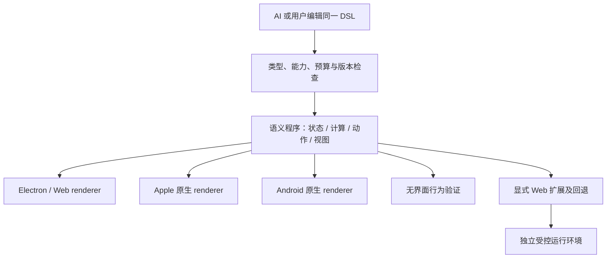

# 交互块 v2：统一语义与多端呈现

状态：2026-11-09 用户确认后已完成 portable v2 第一版：字符串输入、通用计算、BPE 单步演算、表格 / 指标 / 语义图形和流式节点预览。Electron 已通过真实生成与操作验收；Web 扩展和完整原生移动 renderer 仍为后续设计。当前能力契约见 [运行时](interactive-learning-runtime.md)，生成流程见 [AI 生成](canvas-ai-generation.md)。

## 第一版实际范围

- 新增 `nomi-interactive-ir/draft-2` / `portable.learning/draft-2`，旧 draft-1 保留。12 个组件，声明式输入、状态、纯计算和动作；不包含 DOM、JavaScript 源或外部依赖。
- `TextInput`、`Metric`、`Table`、`Scene`；后者只有受校验的 rect / circle / line / text 和语义颜色，可由其他平台原生绘制。Web 采用 SVG，窄屏按容器重排。
- 有界字符串状态、`set` 动作、基础数学、数据访问、格式化与版本化 BPE 教学计算。动态数组状态、时间轴、矩阵、通用循环及播放控制未实现。
- 流式响应中，每个完整且可验证的节点子树会提前显示；完整结果仍独立校验、一次提交。停止 / 失败丢弃预览。
- 实际调用模型生成 BPE 和正弦波实验，并继续聊天修改波形；验证输入、单步、重置、曲线 / 小球 / 数值联动。生成结果已作为合成 fixture 保留。详见 [验收记录](interactive-v2-validation.md)。
- 390px Web 窄屏和深色检查不等于 iOS / Android renderer 已交付。Swift 参考仍仅覆盖 draft-1；v2 原生端须新增 capability 和同值测试后才可宣布支持。


## 目标与核心决定

同一份 DSL 描述内容、状态、计算和操作含义，各端选择适合自己的呈现。Electron 可以用 React、SVG、Canvas；手机可以用 SwiftUI、Compose 或受控 WebView。跨端必须一致的是计算结果、状态转换、身份与保存规则，不是像素、DOM 或控件库。

默认发展可原生实现的 portable 语义；同时设计受隔离的 Web 扩展，容纳 HTML / JS、复杂动画与 3D。不能把任意 HTML 包一层 JSON 就声称可以转换为原生 UI。Web 扩展必须声明实际依赖与回退方式。

产品中仍只有一个「交互块」类型，用户不必先选技术方案。AI 根据需求和目标能力选择实现；能力不足时不拿静态说明图或无关温度滑块冒充实验。

## 实施前质量瓶颈

2026-11-09 代码审查范围：`packages/core/src/interactive/types.ts`、`packages/core/src/canvas/generation.ts`、`packages/host/src/canvas-generation-prompt.ts`、`packages/ui/src/interactive/InteractiveRenderer.tsx`。

| 实施前事实 | 对生成质量的限制 |
| --- | --- |
| 8 个组件：Panel、Row、Text、Button、SegmentedControl、Slider、Math、Plot | 缺少文本输入、动态表格、向量图形、时间轴等表达能力 |
| 3 个计算函数：softmax、array.at、array.replaceAt | 不能计算任意语料的 BPE、矩阵过程或一般模拟 |
| 状态只有 number / enum / 固定数值 vector，动作只有 reset | 不能自然描述动态输入、增删列表、单步演算与局部状态更新 |
| 提示词主要携带 Temperature 样例 | 容易把不同需求套成同一种演示 |
| 文稿验收要求绑定的 Slider / SegmentedControl | 只能证明存在控件，不能证明实现用户所需的交互 |
| 输出上限 32,000 个 JavaScript 字符串长度单位 | 不适合直接塞入大型页面代码、依赖与数据 |

现有模型通道、文稿上下文、流式草稿与原子写入可以沿用。提高质量需要同时扩展表达能力、生成指导与行为验收，不能只改提示词。当前 Swift 实现是计算参考，不是已经交付的原生交互块 UI。

## 协议分层



| 契约 | DSL 负责 | 各端实现负责 |
| --- | --- | --- |
| 内容 | 节点 ID、文字、单位、公式、图形语义、辅助说明 | 字体、字号适配、无障碍语义映射 |
| 数据与计算 | 类型、范围、函数版本、派生关系、显式 seed / 时间 | 执行内核、调度、缓存；遵守相同精度容差 |
| 操作 | 修改参数、提交输入、下一步、重置等状态转换 | 鼠标、触控、键盘、系统控件 |
| 布局 | 阅读顺序、分组、最小可读宽度、优先级、可折叠区域 | 桌面两栏或手机上下堆叠；不照搬固定桌面坐标 |
| 动效 | 哪些值变化、持续时间、播放进度、可暂停 | Web 动画或原生动画；减少动态效果时直达结果 |
| 能力 | 必需 / 可选能力、版本、回退表示 | 能力协商、实现选择、降级反馈 |

例如同一 Temperature Lab 在 Electron 左侧控件、右侧曲线；iPhone 先曲线再放紧凑控件；iPad 可并排。修改温度后，三端的概率值和 Reset 结果相同。地图可采用不同系统地图提供者，但选择地点应保存坐标 / 地点身份，不能保存 Google DOM 或 Apple 私有对象；地图仅为契约例子，不纳入首批能力。

统一语义保留当前 JSON IR 路线；暂不为此次设计替换成另一种文本语法。OpenUI 可以作为后续作者前端候选，前提是表达式、动作、稳定身份及未知信息往返无损，不让 OpenUI 源和 Nomi IR 成为两份互相覆盖的真相。

## 两种执行 profile

### Portable：默认路径

以下为完整目标 catalog；第一版已交付子集见文首，其余仍未实现：

- 输入：文本、多行文本、数字、选择、开关；有界 string、boolean、list、record 状态。
- 展示：表格、列表、数值指标、通用图表和平台中立 2D 图元。图元是 path / text / transform 等有类型的数据，不是 SVG HTML 字符串。
- 计算：严格数值运算、比较、条件、有限集合转换与版本化领域模块；拒绝隐式字符串数值转换、非有限数及无限循环。
- 动作：有类型的 set / reset / 有界列表变更和单步状态机；事件原子执行，失败不留下部分状态。
- 动画：显式时间轴及值插值；动画不改变数学真值，暂停后仍能阅读结果。

复杂算法通过版本化计算模块注册，不让 AI 自造函数名就获得执行能力。BPE 首批可使用经过验证的教学模块；模块以后必须由每个平台实现，或使用通过一致性测试的共享内核。未实现的平台声明缺少能力，不能以“原生支持”名义展示假结果。

### Web 扩展：表达能力的出口

允许两种明确的用途：

1. **Portable 的可选 Web 视图。** 程序仍有完整 portable 视图、计算和动作；Web 视图只接收结果快照、发送已声明动作。例如 Electron 用 anime.js 增强矩阵变换演示，手机使用原生图形动画。切实现不改变程序或个人状态。
2. **Web-only 程序。** 任意 JS 计算或场景没有 portable 等价物时，明确采用拟议的 `web.sandbox` profile。支持它的手机可用受控 WebView；不支持时展示保存的静态预览及简短提示，保留完整源码。静态预览不是同等交互实现。

Three.js / anime.js 属于 renderer 或扩展运行环境的实现依赖，不是每端必须解释的 DSL 原语。首批优先 2D；只有学习任务确实需要空间旋转、遮挡等能力才引入 3D。不能承诺 JS 自动翻译 Swift / Kotlin。

### 能力选择与语义示例

宿主先匹配 profile 与函数 / 组件版本，再根据用户设备、输入方式、可用宽度、无障碍偏好和资源预算选择实现。不把设备型号写成内容逻辑。不支持可选增强就回退到 portable；缺少必需能力则不执行，显示安全替代并保留原件。导出也是一个需协商能力的目标。

下面是概念 DSL，不是 draft-1 可导入 JSON；命名和编码将在实现阶段确定：

```text
program temperature-lab revision 2
  profile portable.learning/v2
  state temperature: number [0.2..3.0] = 1       scope user
  state logits: vector<number,3> = [2,1,0.1]    scope user
  derive probabilities = math.softmax@1(logits, temperature)
  action set-temperature(value) -> set temperature
  action reset -> reset [temperature, logits]
  view
    group responsive-stack
      plot probabilities / sampled-curves
      slider bind temperature action set-temperature
      button action reset
  optional-view web-animation
    requires nomi.web-view-bridge@1
    entry asset:temperature-view
    reads [temperature, probabilities]
    actions [set-temperature, reset]
    fallback portable-view
```

Web 视图不再维护第二份 temperature。宿主校验动作类型、范围和频率后执行，再发送带 revision 的新快照；视图不能自己声称“已保存”。Web-only 程序的持久状态同样通过声明的有界桥接契约导出，不依赖 WebView localStorage。

## 文件、身份与兼容

沿用 [文件包契约](nomi-package-format.md)：`interactive/<blockId>.nomi-ui.json` 是程序定义，`assets/` 放声明过的原件。拟议 Web 源模块也作为内容寻址资产保存，程序引用其资产 ID、MIME、摘要、运行环境版本和入口；不新增第二份可互相覆盖的 HTML 主文稿。内嵌画布沿用现有场景与资产归属规则。

运行时依赖从应用内版本锁定的资源目录提供；打开文稿不在线安装 npm 包、不从 CDN 拉取任意脚本。独立离线导出需携带许可证允许的依赖及完整性信息；当前文章导出不因此自动获得 Web 扩展支持，缺能力时只导出安全预览与原件下载。

程序定义、个人学习状态、设备视图状态继续分开。AI 改文案或布局保留 block / state ID 与兼容学习值；改变状态类型、算法版本或数据含义需明确迁移，不能复用旧值制造错误结果。当前文稿 AI 调整仍创建新块、重置进度，稳定身份是本提案的新增工作。

新必需语义使用显式新 schema / profile。不能通过 draft-1 的未知附加字段偷渡脚本。旧客户端目前可能拒绝不支持的程序，不能承诺自动忽略并正确显示；部署顺序必须先做安全回退 / 无损保留，再启用新内容生成。外部 AI 编辑先写资源再原子发布定义；无效候选继续保留最后可用版本。

## 生成与使用体验

1. `/ai` 在光标或选区旁展开短输入框，发送后停靠侧边。上下文继续遵守现有标题、选区及前后各 1,500 字符的范围，不自动读附件或其他文稿。
2. 内部先生成简短交互计划：学习目标、输入、可见结果、动作、需要的能力与验收断言。产品界面不显示这些工程细节。
3. 根据任务检索能力说明与少量不同范例：参数探索、逐步算法、空间可视化。不是每次注入全部目录，也不是所有问题都给 Temperature 范例。
4. Portable 流式内容只展示已闭合且通过校验的子树；控制引用尚未完成时先展示局部占位。完整交互依赖图就绪后才可操作。
5. HTML / JS 必须完整收齐、校验和验证后再运行。流式体验来自 DSL 组件、章节骨架、已验证模块的逐步出现，不能执行半截脚本或每个 token 重建 iframe。
6. 首次生成在临时层展示，通过最终校验后作为一笔可撤销事务插入；调整保留上一次成功结果，新版本准备好后整体切换。关闭 / 停止 / 文稿切换取消请求，迟到候选不写入。
7. 右侧对话保留，可继续要求改变实验。修改只针对本会话允许的块并校验 baseRevision；手动修改冲突时不覆盖用户内容。普通滑块、下一步和动画本地执行，不再调用 AI。

界面只保留短状态、停止 / 重试等必要操作。状态、能力选择、校验日志默认不泄露到正文。桌面 hover 的必要功能在触屏上必须有等价按钮；键盘与读屏路径不依赖 hover。无动画模式、深色模式、320pt 可用宽度均须可用，横向数据区可内部滚动但不能撑坏整篇文稿。

## Web 扩展的执行边界

以下是实现前的门槛，不是当前已具备的能力：

- 生成代码永远是不可信内容。隔离环境无 Node、宿主 preload / IPC、账号凭据、文稿存储权限；只获得本块明确传入的数据。主 UI 的 CSP 不整体放宽。
- Electron 先验证可独立销毁的 WebContents / 隔离 session 路线；内嵌视图的滚动、裁切、叠层和焦点需要原型实测。单纯添加 `iframe sandbox="allow-scripts"` 不等于独立进程，更不保证死循环不会卡住正文。
- 独立 origin / 响应策略加载生成模块，脚本按摘要核验。当前主页面 `frame-src 'none'` 与继承的 CSP 不能靠插入 srcdoc 绕过；不为支持它加入主应用级 `unsafe-eval`。
- 默认拒绝外网请求、任意本地路径、导航、弹窗、下载、表单提交及设备权限。除 CSP 外还在宿主拦截请求和导航；使用有限资源映射，不能只校验首个 URL 而放过跳转。
- 消息桥只接收登记的来源、会话、协议版本及有界结构；拒绝旧 revision、未知动作、大对象和高频消息。opaque-origin 消息不能只靠 `event.origin` 判断，应绑定实际 frame / WebContents 与当前会话。
- DOM / JS 无法只靠正则或 Promise 超时可靠限制 CPU、内存与 GPU。必须验证宿主侧 watchdog、停止 / 销毁与资源回收；没有证明能保正文可用之前不开放任意 JS。移动端单独验证其进程与资源限制，不沿用 Electron 的结论。
- 离屏 / 后台暂停动画，按可见性挂载。销毁时释放计时器、Worker、图形资源与桥接监听。运行失败保留原文和最后可用结果；显示短重试入口。

首批资源预算由宿主设硬上限，内容只能降低不能提高。模块大小、消息大小 / 频率、列表长度、采样点数、计算步数分别度量；不能简单删除现有 32,000 字符上限。具体数值在原型基准后锁定版本。依赖引入按仓库 [供应链约束](../SUPPLY_CHAIN_SECURITY.md) 审核，安全基础见 [Electron 官方建议](https://www.electronjs.org/docs/latest/tutorial/security)。

## 质量验收：从“有控件”到“实验成立”

模型输出的测试只是候选，最终判定依赖宿主的独立测试和人工体验。Web 页面发出 `ready` 或自报断言成功不算通过。

| 样例 | 必须做到 | 不能接受 |
| --- | --- | --- |
| Temperature Lab | 两种探索模式、改变 logits / 温度、图表与数值联动、Reset；概率和约为 1、大 logits 稳定、明确温度范围 | 曲线是静态图片；滑块仅改变标签 |
| BPE 教学实验 | 输入任意受限语料与频次，展示 pair 计数、单步合并、merge rules 与 vocabulary，支持重置 / 回看 | 固定 low/lower 截图；语料改变后仍播放旧结果 |
| 矩阵乘法 | 可修改小矩阵，选择结果单元展示对应行列与乘加过程，维度错误可恢复 | 动画好看但数字写死或索引对应错误 |
| Web 扩展验证样例 | 受控 2D 动画，与语义状态桥一致；不支持增强时 portable 版本仍可操作 | 用静态截图声称跨端交互等价 |

BPE 第一版明确是字符级教学模型，不声称等同模型生产 tokenizer。规范固定 Unicode 单元、词边界标记、频次计数、并列 pair 选择顺序与非重叠替换规则；这些都进入同源 fixture。温度的熵变化与具体单个 token 概率变化不能混用断言，避免错误的“所有概率随温度单调”测试。

验收层次：

1. 结构：类型、依赖、稳定 ID、能力、循环引用、资源预算与未知版本。
2. 计算：独立固定输入 / 输出及性质测试；TS / Swift / Kotlin 使用同一组动作轨迹，浮点在约定容差内，离散步骤完全一致。
3. 行为：真实输入、拖动、下一步、重置、连续 AI 修改、撤销、重开和学习状态迁移。
4. 视觉：桌面与窄屏、触屏、浅深色、长标签、大字号、减少动态效果；控件确实能触达，图形和关键数值清晰。
5. 运行：离线、后台恢复、多个交互块、长文稿滚动、取消与超预算；恶意导航、消息洪泛、死循环与资源耗尽不危及主文稿。

初始性能验收目标：指定参考设备上，常见控件到视觉反馈 p95 ≤ 100ms；长计算不阻塞文字输入，交互块离屏后停止持续绘制。记录设备、样本数、冷暖启动及内存曲线，不把不同系统 FPS 当同一个保证。

生成评估使用固定且不同于提示词范例的任务集，同一模型 / 提示词版本至少重复 5 次；记录首轮有效率、交互任务通过率、修复次数、首个有用预览时间、总耗时与成本。最多 2 次有界自动修复，失败保留上次结果并提供重试。程序可运行和内容正确分别评分。

## 确认后的实施顺序

| 阶段 | 产物 | 退出条件 |
| --- | --- | --- |
| 1. Portable 纵向切片 | 新状态 / 动作 / 计算契约，文本输入、表格、2D 图元，Temperature 与 BPE | 可编辑、可保存、断网可用；同源计算 fixture 与最小移动端原生 UI 原型通过 |
| 2. Web 隔离原型 | 单块受控运行、消息桥、固定本地依赖、停止与回退 | 正文输入 / 滚动不中断；资源 / 导航 / 恶意代码测试证明边界，未过不生产启用 |
| 3. 生成质量闭环 | 按能力规划、多范例、行为验证、有界修复、增量预览与稳定 ID 调整 | 同一任务集显著优于现有基线，失败不损坏用户内容 |
| 4. 增强与多端交付 | 原生交互 renderer、可选 anime.js / Three.js、离线导出 | 每个目标实际通过能力与往返验收，不把桌面成功等同移动成功 |

先用两个真实实验检验架构，不先做通用 IDE、任意 npm 安装器或自动 JS → 原生编译器。阶段 1 的原生原型用于尽早暴露协议耦合，并非要求第一轮交付完整手机应用。实现前还需确定隔离载体的可用性与具体预算；这些由工程原型验证，不让用户在界面里选择底层技术。

## 外部参考与适用范围

- [Open Intelligent UI](https://github.com/thesysdev/open-intelligent-ui) 展示组件组合与交互生成方法，是独立开源参考，不是 ChatGPT 内部实现的证据。
- [HtmlView 源码](https://github.com/thesysdev/open-intelligent-ui/blob/03213439358bf3408ad61a46ec9e3230c5572e48/src/lib/components/html-view.tsx) 将 HTML 放入仅允许脚本的隔离 iframe，并在流式结束后运行。借鉴分层，不沿用其在线资源策略。
- [生成提示样例](https://github.com/thesysdev/open-intelligent-ui/blob/03213439358bf3408ad61a46ec9e3230c5572e48/src/lib/prompt-options.ts) 提供不同任务的组合范例；Nomi 应建立自己的学习任务目录和验收样例。
- [ChatGPT Intelligent UI 说明](https://help.openai.com/en/articles/20001598-intelligent-ui-in-chatgpt) 可用于体验目标对照，不据此假设存在已公开的内部 DSL 或可直接复用的生成接口。
- 更完整的源码版本、语言差异与证据见 [参考评估](../references/openui-genui-review.md)。
