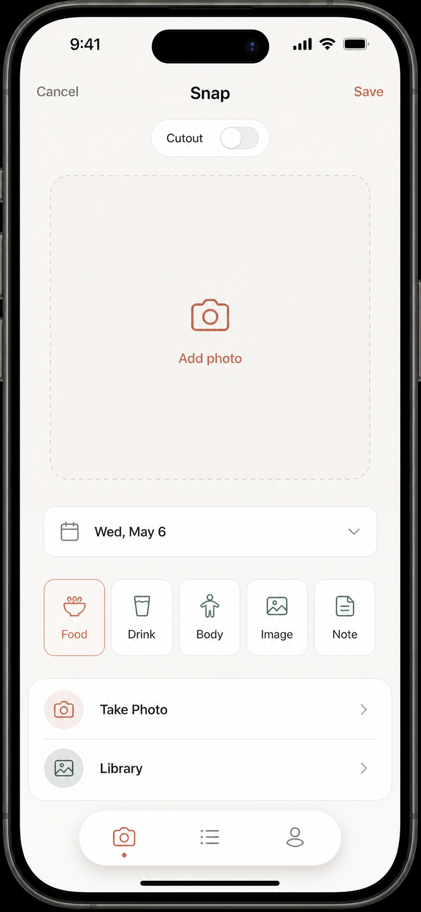
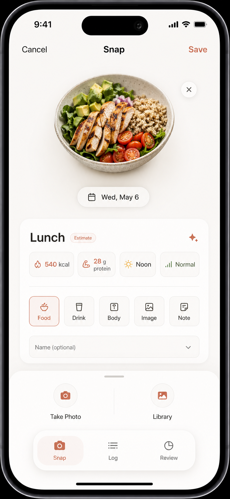
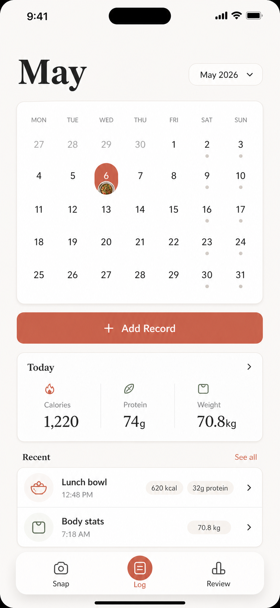
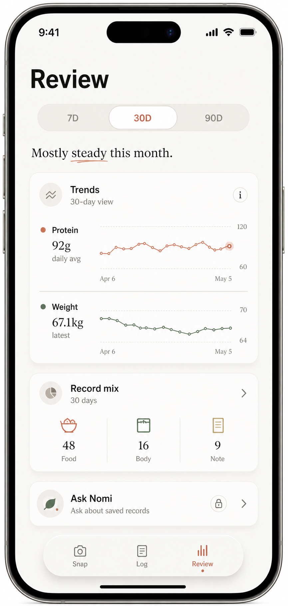
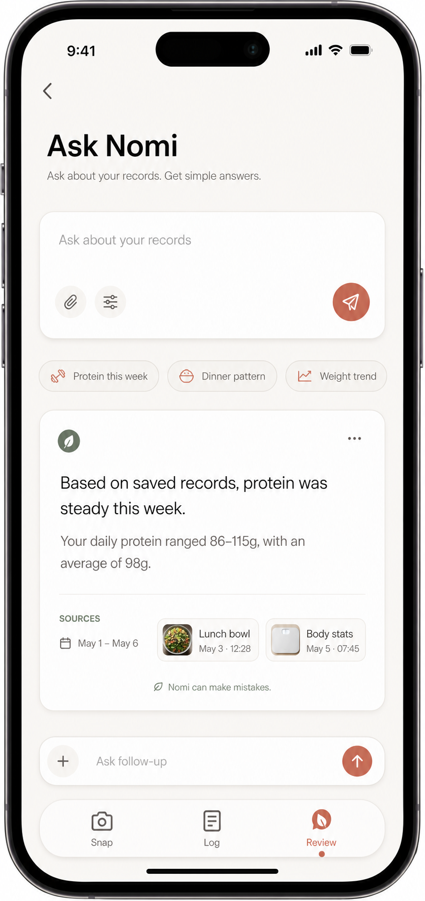

# Nomi Mobile UI/UX Less-Is-More Screens

本目录保存上一阶段基于 `Snap / Log / Review` 信息架构探索出的移动端 UI/UX 设计图。当前 mobile app 已进一步收口为 upload-only 工作台；这里作为视觉语言、留白、色彩和轻量交互的归档参考，不再代表当前要逐页实现的产品结构。

## 设计目标

- 用户不需要学习就能完成核心动作：拍照、保存、回看、提问。
- Capture / Snap 是主入口，其他页面只服务记录回看和轻量复盘。
- 保持 `docs/DESIGN.md` 的方向：quiet、personal、less is more、Apple-like。
- 参考同类小众设计导向 App 的大留白、强主动作、轻卡片和浮动底栏，但不照搬具体产品内容。
- 不出现医疗诊断、风险评分、红黄警示、治疗建议或重 dashboard 视觉。

## 页面拆分

上一阶段主入口是 `Snap / Log / Review` 三个 tab。这里按当时的实现粒度拆成 5 张设计图：

| 文件 | 对应功能 | 参考含义 |
| --- | --- | --- |
| `01-snap-empty.png` | Snap 空态 | 初次进入拍照页，只保留拍照、图库、记录类型和日期。 |
| `02-snap-ai-review.png` | Snap AI review 态 | 用户添加图片后展示估算结果，支持快速确认和少量 chip 修改。 |
| `03-log.png` | Log | 月历、今日关键指标、最近记录和主 Add Record 入口。 |
| `04-review.png` | Review | 用少量趋势和记录组合做温和回顾，不做复杂健康 dashboard。 |
| `05-ask-nomi.png` | Ask Nomi | 虽然当前嵌在 Review 内，但作为有来源的个人记录问答功能单独沉淀。 |

## 设计图

### v3 earth morandi

如果后续需要回看这组视觉探索，优先参考 `v3-earth-morandi/`。这一版保留 v1 更大气、更有设计感的方向，同时用同一个 HTML/CSS 设计系统控制多页一致性。整体色系改为暖色、大地色和莫兰迪色调。

- `v3-earth-morandi/01-snap-empty.png`
- `v3-earth-morandi/02-snap-ai-review.png`
- `v3-earth-morandi/03-log.png`
- `v3-earth-morandi/04-review.png`
- `v3-earth-morandi/05-ask-nomi.png`

### v2 consistent system

这一版用于修正 v1 的多图漂移问题，但视觉气质偏弱，保留作一致性控制参考。

- `v2-consistent-system/01-snap-empty.png`
- `v2-consistent-system/02-snap-ai-review.png`
- `v2-consistent-system/03-log.png`
- `v2-consistent-system/04-review.png`
- `v2-consistent-system/05-ask-nomi.png`

### v1 generated references

## 实现备注

- 后续如果从这些图里提取视觉语言，应优先复用大标题、大片空白、单一主动作、轻量白色 surface 和浮动底栏这些原则，而不是照搬旧的信息架构。
- Capture 里让用户选择多于输入；可选输入字段应收起或弱化。
- Ask 的回答必须继续显示时间范围和来源记录，保持非医疗边界。
- 如果某张图的细节和 `docs/product-specs/nomi-mvp.md` 冲突，以产品规格和非医疗边界为准。
