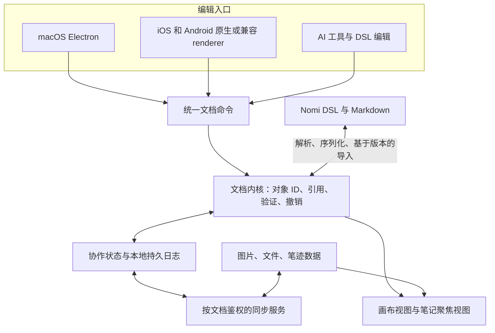

# 笔记与无限画布整体设计

状态：2026-10-18 架构提案；2026-10-19 已完成 [交互学习运行时](interactive-learning-runtime.md) 的首个纵向切片，新增 [画布主工作区](canvas-workspace-runtime.md)：Note / Block / Placement、长笔记 / 附件 / 交互块与本地恢复已运行；手写、格式化文件包与同步仍待实现。用户已确认：第一版以完整长笔记放在无限画布中为主，支持 Markdown / LaTeX、图片、文件和手写；未来在 macOS、iPad、iPhone 之间继续编辑。DSL 是必要条件。后续 GenUI 及独立原生 renderer 要求已纳入 [交互内容修订](generative-interactive-content.md)，涉及平台与交互的取舍以修订为准。

## 核心方案

构建一个以可寻址内容为中心的笔记系统，画布是组织与编辑这些内容的空间视图。长笔记、图片、附件和笔迹有稳定身份；在画布上的位置、大小和层级单独保存。Nomi DSL 定义这些对象的公开语义及可读文档表示，UI 和 AI 通过同一套命令修改它们。

长期共享的是平台中立文档 / 交互协议及一致性测试。首批 Electron 可用 TypeScript / React 参考实现；未来 SwiftUI / UIKit、Compose renderer 可独立实现。WebView 是可选兼容路径，不是移动端前提。采用本地优先存储，从早期验证多端离线合并。GenUI 的状态、计算、事件与能力边界见 [交互内容设计](generative-interactive-content.md)。



## 用户体验与第一版范围

桌面打开一个文档后，主区域是可平移、缩放的画布；双击空白处创建笔记，把图片和文件拖进来创建对象。笔记可以包含长文、公式、图片、附件与专门的手写区域。普通文本默认无标题；有需要时直接在顶部添加或修改标题。每个框支持从四边和四角拖动调整大小。双击笔记默认原位编辑，点击外部或「完成」恢复渲染；通过标题栏放大图标进入聚焦视图完整阅读、编辑与实时预览。

同一份笔记支持两种布局：画布中的宽度固定，保持空间关系；聚焦视图按当前设备宽度排版，不改画布坐标。iPhone 首先保证长文编辑、附件查看和内容修改可用，并保留缩略总览及定位回画布的入口；精细排布不强求在小屏上和桌面一样高效。iPad 同时提供触控组织与 Pencil 手写。

第一版协议与原型还要包含可离线求值的 InteractiveBlock，支持滑块、状态、图表、公式和 Reset；它与文本、图片、文件、基础笔迹、移动 / 缩放、选择、删除、撤销与本地恢复共同构成边界。连线、框选分组、跨文档嵌入、复杂表格、完整富文本工具栏和 PDF 精确批注在后续扩展；基础数据模型预留这些能力，不在首版一次做满。

## 参考产品的底层结构

成熟方案通常保存结构化对象、坐标、引用和附件，再由编辑器渲染，不以一张大图片作为可编辑文档。Excalidraw 的公开场景格式是含 elements / appState / files 的 JSON；JSON Canvas 定义了文字、文件、链接、组和连线，其中文字可使用 Markdown。这说明公开文本格式和画布可以结合，但这些已有格式不能直接替代 Nomi 所需的长笔记、笔迹与 AI 编辑契约。[Excalidraw 格式](https://docs.excalidraw.com/docs/codebase/json-schema/)、[JSON Canvas 规格](https://jsoncanvas.org/spec/1.0/)

BlockSuite 的 page 与 edgeless editor 可挂载同一个文档对象；这一点支持“同一内容有不同视图”的架构方向。tldraw 则明确区分需要持久化的 document 与本地的 camera / selection 等 session 状态。Nomi 借鉴这些边界，不把第三方编辑器的内部 schema 固定成自己的长期格式。[BlockSuite](https://blocksuite.io/components/editors/edgeless-editor)、[tldraw 持久化](https://tldraw.dev/docs/persistence)

以上是来源事实；下文的数据模型、同步策略与技术组合是针对 Nomi 的设计建议。

## 文档对象模型

| 对象 | 职责 | 关键约束 |
| --- | --- | --- |
| Space | 文档集合及个人 / 家庭授权容器 | 第一版默认个人私有；不自动继承现有家庭全共享 |
| Document | 离线打开、同步、备份的单位 | 持有内容、画布和附件 manifest；首版按整文档授权 |
| Note | 完整笔记，含可选标题与有序 Block 列表 | 画布位置不进入笔记正文；初版不嵌套 Note |
| Block | `markdown`、`image`、`file`、`shape`、`ink`、`interactive` 等内容 | 稳定 ID；不是 DOM 节点 ID，也不是数据库自增序号 |
| Board | 一个文档中的空间视图 | 首版一个主画布；模型允许未来增加视图 |
| Placement | 把 Note 或 Block 放到 Board 上 | 有独立 ID、content 引用、位置、宽度、可选高度、展示方式和顺序 |
| Connector | 绑定两个 Placement 的侧边，承载线型、箭头与标签 | 当前 JSON IR 已实现；不是正文引用或两个内容对象的隐式关系 |
| Asset | 不可变附件原件 | 随机资产 ID + digest + MIME + 长度；二进制不内联进 DSL |
| Recognition | 对笔迹 / 图片的识别结果 | 派生数据，带来源 ID、内容版本、范围、识别器版本 |

例如笔记 `n_mechanics` 在画布上有摆放 `p_main`。修改笔记内容会更新所有引用它的摆放；移动 `p_main` 不改正文。图片块既可嵌在笔记中，也可通过单独 Placement 放大展示，仍引用同一资产。

删除一个 Placement 仅移除那处展示；删除笔记 / Block 是内容层动作，必须处理所有引用与回收站。复制展示与复制内容是两个明确操作，不能让用户误以为编辑了独立副本。首版复用只发生在同一 Document 内；跨文档关系另行设计授权和生命周期。

Note 的块顺序是阅读语义，Board 的对象顺序是叠放语义。它们不能用坐标排序互相推导。摄像机、选区、正在输入的 IME 状态、hover、工具面板位置留在设备本地，不进入共享内容。交互块的个人学习参数另有持久 UserStudyState；程序默认值属于文档，拖动过程属于临时视图。三者不能混成同一个状态。

## DSL 的职责与表达

DSL 表达文档内容、空间关系及交互语义。交互层允许类型化的表达式、有界 map / sample 和声明动作；不执行任意脚本，也不在求值时获得隐式网络或宿主权限。Markdown 保留原始文本，数学保留 LaTeX 源码，文件保留原件，笔迹保留可编辑向量数据。AI 不需要从像素反推整张画布。

KDL 2 保留为文档结构的候选语法底座；新加入的交互层优先验证 OpenUI 前端与 Nomi 语义 IR 的映射。语法不先冻结，避免先选定格式再强塞响应式计算。KDL 提供节点、属性、子节点及原始多行字符串；具体 TypeScript parser 的正确性、错误定位与无损保留能力仍需验证。[KDL 官方介绍](https://kdl.dev/)、[KDL 2 规格](https://kdl.dev/spec/)

```kdl
nomi 1

document "d_study" title="力学学习" {
  note "n_mechanics" title="牛顿第二定律" {
    markdown "b_intro" source="text/b_intro.md"
    image "b_figure" asset="a_figure" caption="受力示意"
    ink "b_derivation" source="ink/b_derivation.ink.json" width=640 height=240
    file "b_reference" asset="a_reference"
  }
  board "c_main" {
    place "p_note" content="n_mechanics" x=0 y=0 width=640 height="auto" order="a0"
    place "p_figure" content="b_figure" x=760 y=40 width=360 height=180 order="a1"
  }
  // asset 声明及完整文件见示例包
}
```

`text/b_intro.md` 使用普通 Markdown，包括 `$F=ma$` 与 `$$ ... $$`。正文不必重复转义 JSON 字符串。示例包和规则见 [DSL 草案](notes-canvas-dsl.md) 与 [完整示例](notes-canvas-example/README.md)。

第一版限定一个标准文件化表达：结构在 `document.nomi`，Markdown 与笔迹在包内独立文件，不同时引入多种等价存储写法。未来可以增加用于粘贴 / AI 输出的内联语法，由 formatter 归一化。DSL 的语义 round-trip 必须无损；注释、空白的保留需要语法工具验证，不能把重要用户内容只存在注释里。

## DSL 快照与协作状态的关系

这里必须区分内容语义和并发历史。DSL 定义一份文档能表达什么；CRDT 保存多个副本的修改如何合并。两者可以共存，但不能各自作为可独立覆盖对方的主状态。

建议运行时只维护一个经验证的语义文档副本，内部以 Yjs 等协作类型承载。UI、AI 命令和文件导入最终都作用到这个副本。持久化先原子提交增量日志，再在后台生成匹配该日志位置的 DSL / 正文快照；快照记录版本和内容 hash。重启由最后一个完整快照及其关联的协作 checkpoint / 后续日志恢复。

- DSL 包是可移植、公开、可恢复内容的完整表示，去掉索引、预览和协作缓存后仍能打开编辑。
- 协作日志 / checkpoint 保留 CRDT 身份和因果信息，用于继续原来的同步历史；仅有 DSL 快照不能恢复那些历史身份。
- 从纯 DSL 包新建文档时创建新的协作 epoch；不把它直接冒充原文档的最新副本。
- 正在同步的文档，直接修改磁盘 DSL 必须走导入事务，携带已知基线，做三方比较并转成对象级修改。无基线或有冲突时保留待导入副本，禁止静默全量覆盖。
- 非法语法保持上一个可用版本，给出文件、行列和错误；文件监听器不把 formatter 的输出再次当作外部修改。

默认 AI 通过 CLI / MCP 提交命令；高级用户仍可导出、编辑并导入 DSL。首版不承诺任意网盘同时编辑这些文件就等价于正确的协作同步。

## 长笔记与数学编辑

建议以 Markdown source 为正文权威表示，采用 CodeMirror 6 一类成熟编辑器处理输入、IME、选区与长文，提供段落级实时预览；图片 / 附件 / 手写是 Note 的有序独立块。这样既不需要让用户常看源码，也能保留 AI 最容易读写的原始文本。[CodeMirror 文档](https://codemirror.net/docs/)

不要同时把任意富文本 AST 和 Markdown 两套内容都设为主状态。未来如果要引入 ProseMirror 等完整结构化编辑器，先定义可无损的受限 Markdown 语义与转换测试；不能为了工具栏方便而悄悄丢掉公式、引用或扩展语法。

数学第一版支持行内 `$...$`、展示 `$$...$$`，明确为 KaTeX 所支持的数学语法子集，不承诺任意 LaTeX 文档或包。错误公式保留源码并显示局部错误。关闭不受信任的 HTML / URL 能力，设定宏扩展与公式复杂度预算。[KaTeX 安全约束](https://katex.org/docs/security.html)

画布中的 Note 使用固定逻辑宽度，自动高度由共享排版规则计算；长笔记可切换折叠预览或进入聚焦视图。首版支持画布内激活一篇笔记进入真实编辑态，也支持展开聚焦编辑；未激活笔记使用轻量预览。长文编辑与聚焦视图使用虚拟化，避免把十万字 DOM 随画布缩放一起重排。缩放下的输入光标、IME 候选框与选区必须实测。

## 渲染与坐标

以下 DOM / Canvas 组合针对首批 Electron / Web renderer。其他平台可以使用原生布局、文字、图形与手写实现，但须保持相同坐标、内容和交互契约。

无限画布是一套世界坐标与相机变换，不是一张巨大 bitmap。使用有限浮点世界坐标、缩放及平移；持久化位置独立于设备像素与 Retina scale。坐标、尺寸和缩放必须是有限数并受文档预算限制；“无限”不等于允许无界内存或任意数值。

建议采用混合渲染：

- Canvas / GPU 层承担网格、选框、连线、普通笔迹与大量轻图形。
- DOM 层承担可见的 Note、图片、Markdown / 公式和真实文本编辑器，保留复制、选择、中文输入及无障碍能力。
- 只挂载视口附近对象；用空间索引查找可见和命中项，缩放很小时使用简化预览。
- 字体、公式样式、图片方向与笔刷版本一起约定。不同设备做到内容、坐标及交互语义一致，微小排版差异通过共享字体和布局规则缩小，不承诺不同系统逐像素一致。
- 自动高度、包围盒与缩略图是可重建结果；不要让每次排版测量产生共享编辑或设备之间的同步回路。

是否使用成熟画布库作为渲染适配层，需通过“长文输入、移动端触控、命中测试、坐标和 DSL 双向映射”原型再决定。若会产生两份可编辑 document store，或频繁全场景转换，优先采用较薄的自有视图层。这个选择不意味着自研文本输入、协作算法或笔迹识别。

## 手写的数据与平台适配

笔迹与识别文字是两份不同内容。原始笔迹永远保留；识别 / 摘要只作为带来源的派生结果，用户明确转换后才新增文字块。

通用笔迹格式至少包含 stroke ID、笔刷与算法版本、颜色 / 基础宽度、点序列、时间差、压力，以及可选倾角 / 方位。样本坐标位于 Ink 块本地坐标中，移动 / 缩放 Placement 不重写每个点。落笔过程先本地预览，按笔画或有界 segment 提交；预测点不作为真实采样持久化。Pointer Events 提供压力和 coalesced / predicted events 的接口，但具体设备与 WebView 支持必须实测。[Pointer Events](https://www.w3.org/TR/pointerevents3/)

iPad 的优先候选是原生低延迟输入与共享文档结合。PencilKit 提供可访问的笔画 / 采样数据及原生 drawing representation；它是输入和保真来源的候选，不能只存一个 Apple 专有 blob，然后要求其他端继续编辑。[Apple PKStrokePoint](https://developer.apple.com/documentation/pencilkit/pkstrokepoint-swift.struct)、[Apple PKDrawing](https://developer.apple.com/documentation/pencilkit/pkdrawing-swift.struct)

必须先做转换实验：PencilKit 的 transform、mask、纹理、橡皮结果不一定能等价映射为简单 points。第一版可移植笔刷限定为实线笔与受控荧光笔、整笔删除；原生高级笔刷未通过转换前不开放。必要时保留原生数据作为附加保真资源，但通用采样 / 几何必须足以让其他端显示、选中、移动与删除笔画。局部擦除以后以新片段及删除旧笔画表达，不能仅更新平台 mask。

两种手写位置：画布上的自由 Ink 对象；Note 中随块移动的固定比例 Ink 区域。它们在 iPhone 聚焦视图中等比缩放，不随文字换行拉伸。对某个单词 / PDF 字形的精确覆盖批注需要文本范围 / 页面坐标锚点，是后续能力，不用屏幕像素假装解决。

## macOS 与移动端代码边界

跨端共享协议、schema、表达式 / 动作语义和 conformance fixtures；TypeScript 是首批参考实现。React、SwiftUI / UIKit、Compose 等 renderer 可以分别实现同一组件 catalog。平台可选择共享计算核心或按协议实现，但不能让显示文案、JS closure、CSS 与 React state 成为持久语义。

现有 SwiftUI beta 保留。移动端可按阶段采用原生画布 / 笔记 / 手写，必要时局部使用 WebView，不要求把整个编辑器放在其中。Pencil 输入和存储桥只暴露声明过的能力。原生 Ink 与 Web overlay 的坐标实验仍有价值，但它是实现选择，不约束所有未来客户端。

完整平台矩阵、能力降级与最小 SwiftUI 学习组件验证见 [生成式交互内容设计](generative-interactive-content.md)。

## 本地优先与同步

同一人的两台设备也会产生并发：Mac 离线改正文，iPad 离线补笔迹，重新联网后应同时保留。因此不采用整文件最后写入覆盖。

建议以 Yjs 为首个候选：文字使用 `Y.Text`，内容和摆放按 ID 保存，笔画以不可变对象集合记录。Yjs 的 update 具备可交换、可结合和幂等特性，但这只解决副本收敛，不自动解决用户意图、授权、附件可用性与所有结构约束。[Yjs updates](https://docs.yjs.dev/api/document-updates)、[Y.Text](https://docs.yjs.dev/api/shared-types/y.text)

需要额外定义：

- 同一对象的几何 transform 作为一组原子属性，避免并发把 A 的 x 与 B 的 y 拼成第三个位置；竞争修改保留版本记录，不声称双方意图都满足。
- 删除与修改并发时，内容进入带 tombstone 的可恢复状态；不因另端晚到的移动意外复活。
- 块排序和层级不能依赖简单数组下标；使用独立 membership / order key 与确定性 tie-break，原型验证并发移动没有重复、丢块或循环。
- 撤销只撤销本地对应动作，不回滚其他设备后续操作；AI 批次有独立 origin，作为一次可撤销动作。Yjs 支持按 origin 跟踪撤销，产品仍需定义跨对象动作的行为。[Y.UndoManager](https://docs.yjs.dev/api/undo-manager)
- 附件单独分块上传 / 下载；文档先到时显示 pending，不伪造已可打开。资产是 scope 内的不可变内容，不能凭 hash 绕过授权。
- 本地 durable ack 后显示“已保存在本机”；服务端确认后再显示已同步。应用被杀、断网与磁盘写失败都有明确恢复路径。

客户端内核通过 `DocumentRepository` 接口持久化。桌面可复用现有本地 Go 子进程 / SQLite 运输能力，但新增独立 document 模块，不依赖股票表或当前 localStorage workspace；iOS 使用原生存储或受控适配层，浏览器原型使用 IndexedDB。索引、缩略图和 OCR 均可重建。

跨端原型可新增受 Go API 授权的 Node 协作房间服务，以 TypeScript / Yjs 参考实现验证校验和合并；原生客户端须验证可嵌入的兼容协作核心或适配协议，不能把 JS 实现直接视为平台中立协议。Go 继续负责身份、文档权限、附件与同步票据，Node 处理按文档的副本状态；不要在 Go 中仓促重写 CRDT。原型需验证写入尺寸限制、结构校验、幂等、checkpoint 与鉴权撤销。该服务尚未存在，本轮不部署。

## AI 如何读和改

交互块另支持 AI 生成 / 修改 UI、计算图与动作，并保留个人状态；流式草稿经完整校验后发布，详见 [GenUI 生命周期](generative-interactive-content.md)。

AI 默认读取可理解的内容，而不是所有渲染属性与数百万采样点。提供：

- `get_outline(documentId)`：Note / Block / Placement ID、标题、摘要、版本。
- `read_blocks(ids)`：Markdown 原文、附件 metadata、来源引用、所需公式。
- `read_region(boardId, bounds)`：区域内的内容、摆放和可选局部截图。
- `propose_changes(baseVersion, operations, expectedHashes, requestId)`：基于版本的语义修改。
- `apply_changes(changeId)`：在当前授权范围内校验并原子提交，返回新版本及变更摘要。

操作示例是 `append_block`、`splice_markdown`、`create_placement`、`set_transform`、`attach_asset`。文字修改使用块 ID、精确匹配文本 / 相对锚点与期望版本；不只依赖过期行号。AI 生成思考结构时，可以请求“在这篇笔记右侧放一个总结”，布局工具根据目标对象与视口选择坐标，不强迫模型猜 x/y。

修改前检查目标仍存在、权限、schema、资源和文本预条件。冲突返回差异，让 AI 重新读取；不静默全量重试覆盖用户编辑。变更可预览、有来源及 actor / device / AI run 记录，并可按批次撤销。预览 / 自动应用由用户设置决定，不要求每次改一个字都中断用户。

笔迹理解采用区域图像与可选 OCR / 公式识别，结果引用 stroke IDs、源 hash 和局部区域；AI 可以移动、分类、引用或补充解释，但不能把未经确认的识别文字当作原始手写内容。

## 存储与权限

可移植文档包包括 `document.nomi`、Markdown、笔迹文件及附件原件；`.nomi-state` 中存运行历史、checkpoint 和本地恢复信息，索引 / 缩略图另放缓存。对外可导出为打包文件，不能靠只导出一张 PNG 声称可编辑导出。

第一版按 Document 授权，默认属于个人 Space。加入家庭不自动分享笔记。以后可以显式把文档共享给家庭 / 成员，移动归属必须处理其附件、AI 会话和索引。旧家庭资料 workspace 需要用户明确导入或引用，不能自动把生产资料映射到新笔记系统。

所有文本和附件视为不可信内容：Markdown 不执行 HTML，公式不开放任意受信任命令，SVG / PDF 预览受控，附件路径不能逃出文档包。DSL 中不存登录 token、绝对本机路径或可执行命令。AI 只有用户授权文档范围，派生 OCR / 索引沿用同一访问边界。

## 实施顺序与验收门槛

| 阶段 | 交付 | 进入下一阶段前必须验证 |
| --- | --- | --- |
| 0 核心实验 | DSL / IR codec、Temperature Explorer、React / 最小 SwiftUI、两副本合并与真实 iPad 手写对照 | 正文与交互程序 round-trip；不同 renderer 的状态 / 计算 / 事件一致；离线修改不丢失且笔迹可移植 |
| 1 本地桌面闭环 | 创建文档、画布内与聚焦长笔记编辑、图片 / 附件 / Ink / Interactive、画布摆放、撤销、个人学习状态与保存恢复、DSL 导入导出 | 重启无丢失；中文 IME / 粘贴 / 数学错误可用；外部非法 DSL 不毁坏现有文档 |
| 2 移动与跨端 | 原生 renderer / 输入适配、iPhone 编辑、iPad Pencil、鉴权同步、附件与个人学习状态 | Mac → iPad → iPhone → Mac 内容可继续编辑；断线、重放、取消上传和多端冲突可恢复 |
| 3 AI 编辑与 GenUI | 分范围读取、交互程序生成 / 发布、语义修改、差异、批次撤销 | AI 只改目标内容；不覆盖并发编辑或学习进度；流式草稿不执行效果；识别结果保留来源 |
| 4 深化组织 | 多画布、连线、分组、复用、搜索、锚定批注与家庭共享 | 增量扩展不改变已有文档语义，不破坏旧客户端内容 |

上述阶段需按 [交互内容修订的实施顺序](generative-interactive-content.md) 调整：协议阶段加入 Temperature Explorer，并以同一 IR 提前验证 React / 最小 SwiftUI renderer。

阶段 0 需提早用真实 iPad，不等桌面 UI 完成才发现笔迹方案不可行。原型性能目标是常用设备平移 / 缩放接近屏幕流畅刷新、输入无可感知长阻塞；用至少 1,000 个摆放、10 万字长笔记和 20 万采样点分别压测，记录设备、可见对象数、内存、首次打开与输入延迟。具体指标根据真实硬件基线确定，不把推测数字写成已达标。

## 当前建议与待实测项

可以确定：长笔记优先、DSL 契约、内容与摆放分离、跨端保留可编辑向量笔迹、本地优先、统一命令入口、个人默认私有。

推荐但尚待实验：文档层 KDL / 交互层 OpenUI 前端与 IR 映射、Electron 的 CodeMirror / KaTeX 和 DOM + Canvas、Yjs 与原生兼容路径，以及独立原生 renderer / 输入能力。最高风险是原生笔迹和通用格式的双向编辑、长文与画布交互、以及外部 DSL 导入与协作历史的接合。本轮形成设计，不把这些候选标成已实现能力。
